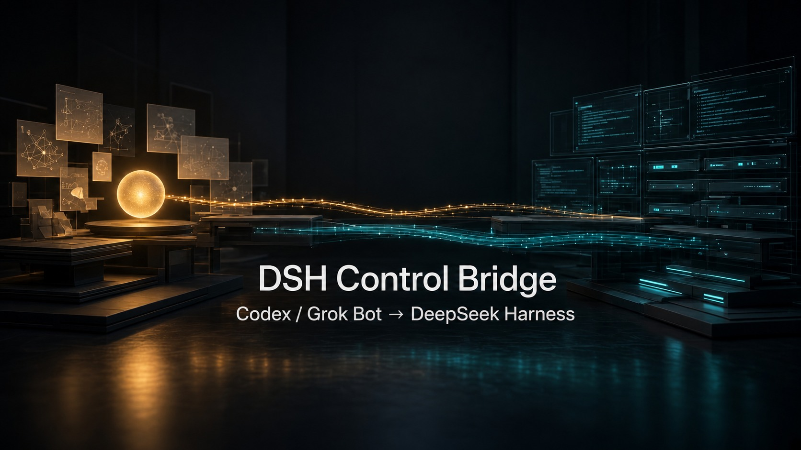

# DSH Control Bridge

[](README.md) [](README.en.md) [](README.fr.md) [](README.ja.md) [](README.ko.md) [](README.de.md)


六种语言的项目介绍与快速开始见上方标签。详细操作手册目前以中文为主，命令、参数与协议字段保持原文。

让 Codex、Grok Bot 或自己的协调程序把任务交给指定的 DeepSeek Harness 工作区，并跟踪执行结果。**已经在同一台电脑使用 Codex 和 Harness Desktop？从 Codex skill 和 Desktop Host 开始。** 这条路径只连接本机 Host，安装好后即可在 Codex 里用自然语言操作。

[Super Agent 驾驶舱](plugins/dsh-superagent-cockpit/README.md) · [Codex 技能 v0.2.3](https://github.com/ft54482/dsh-control-bridge/releases/tag/skill-v0.2.3) · [Desktop Host v0.2.2](https://github.com/ft54482/dsh-control-bridge/releases/tag/v0.2.2) · [文档目录](docs/README.md) · [端口配置与排错](docs/ports.md) · [Windows 真机验收](docs/verified-scope.md)

## 选一个入口

| 你的环境和目的 | 安装或运行什么 | 第一次验证 |
| --- | --- | --- |
| Codex 桌面端，希望继续旧会话或为新任务开主控会话 | 在 Codex 安装 **skill**，在 Harness 的 desktop profile 安装 **Host 插件** | 用 skill 执行 `health` 和 `granted`。[安装与配对](docs/windows-delivery.md#codex-desktop-setup) |
| 自己的 Bot 或脚本，需要多实例、收件箱、任务审批和审计 | 安装 Python **协调桥**，用 `dsh-bridge` CLI 操作。需要接收签名 HTTP 事件时再开 `serve` | 先用 fake 跑完一次起草、发送和交卷。[协调桥指南](docs/coordinator.md) |
| 已有工具客户端，希望用 MCP 读收件箱或起草任务 | 由客户端启动同一个 Python 协调桥的 `mcp` 子命令。v0.2.2 使用 `Content-Length` 消息帧，客户端需支持此格式 | 用兼容客户端调用 `tools/list`。仅支持逐行 JSON 的客户端可先用 CLI。[MCP 配置与工具](docs/coordinator.md) |
| 在终端或 CI 运行独立的 Harness 普通会话 | 给 Python 协调桥配置 `headless_cli` 适配器和独立的 headless profile | 先用默认的 `spawn = false` 核对配置。[Headless CLI](docs/headless-cli.md) |
| 想在 Harness Desktop 查看任务槽和各实例工单 | 安装可选的 **Super Agent 驾驶舱**，多实例时启动随包聚合器 | 上方按主控登记表显示任务，旁边是活会话数，各实例卡片显示工单执行器占用。[下载与安装](plugins/dsh-superagent-cockpit/README.md) |
| 已部署 SuperAgent，希望从 Codex 派发和追踪工单 | 用技能自带的 `github_source.py` 核对目标实例、GitHub 仓库和发件账号 | 从 `precheck` 开始。发送获授权的 Issue 或评论后，用同一份计划追踪 Ticket、Assignment 和 worker 结果。[操作指南](skills/deepseek-harness-bridge/references/superagent.md#github-source) |

目录对应关系可看[组件与运行位置](docs/README.md#仓库里的几个名字)。

## Codex 桌面端快速开始

1. **装 skill。** 将独立技能 ZIP 解压到个人 `~/.agents/skills/`。已配对的用户可以复用原 Host 和授权。首次安装还需下载兼容的 v0.2.2 Host TGZ，以及提供 Windows 安装脚本的便携源码 ZIP（已有源码检出也可）。[Skill ZIP](https://github.com/ft54482/dsh-control-bridge/releases/download/skill-v0.2.3/deepseek-harness-bridge-0.2.3-skill.zip) · [Host、便携包和 SHA-256](https://github.com/ft54482/dsh-control-bridge/releases/tag/v0.2.2)
2. **装 Host 并配对。** 使用 Python 3.11+。按 Windows 手册把 Host 装入实际使用的 desktop profile，在目标工作区选择一条空闲会话，并把长期凭据文件的路径配置给 skill。只查历史可选 `read`，要派工则选 `write`。[安装与配对](docs/windows-delivery.md#codex-desktop-setup)
3. **先查连接。** 在 Codex 输入「用 `$deepseek-harness-bridge` 检查本机连接，列出已授权会话」。要新建主控会话，再确认同一 profile 已装 `master-control` 预设、Host 已开启会话创建，且 `health` 返回 `preset_create_verified=true`。自定义端口请一并告诉 Codex。[非默认端口示例](docs/ports.md#desktop-host)
4. **按任务选择会话。** 可以说「找到上次修导出的会话，继续处理失败用例」，也可以说「在同一工作区开一个新的主控会话，处理这项独立任务」。创建成功后，skill 从实际会话读回预设，再派工并按请求 ID 跟踪官方终态。[会话命令与验收字段](skills/deepseek-harness-bridge/references/desktop.md#new-work-in-master-control-mode)

## 我的端口与示例不同

| 你要访问的服务 | 默认连接 | 改哪两端 |
| --- | --- | --- |
| Harness Desktop Host | `127.0.0.1:8765` | Host 插件配置的 `port`，以及配对时的 `--url`、skill 每次调用的 `--port` |
| Python 协调桥的签名事件入口 | `127.0.0.1:8787` | 启动 `serve --port`，并更新事件发送方的 `/v1/events` URL |
| SuperAgent 管理服务 | helper 默认访问 `127.0.0.1:3082` | 读取目标 profile 的实际监听端口，传给 `superagent.py --port 端口 state` |
| 协调桥 MCP | 本地子进程的标准输入、输出 | 配置启动命令、配置文件和数据目录；无需分配 TCP 端口 |

只配置所选入口用到的服务。fake 示例里的 `:9`、`:10` 是占位值。完整指南以非默认端口演示如何配对，以及如何区分连错服务、凭据错误和工作区未授权。[端口配置与排错](docs/ports.md)

## Python 协调桥快速开始

在仓库根目录用 Python 3.11+ 运行以下命令。fake 示例在本机模拟完整流程，无需 Harness 凭据或模型额度。

```sh
python -m pip install -e .
python examples/e2e_fake.py
dsh-bridge --config examples/config.example.toml check
```

示例故意让 `local-desktop` 和 `lab-server` 都有一个 `broadcast-cs` 工作区。派工时按实例和工作区共同定位。任务记录区分普通会话 `ordinary_session` 和长程任务 `superagent`；默认 `draft`，发送需要操作者提供 `mandate`。fake 生成的 ticket/run 用于演示。追踪正式 Assignment 要去对应 SuperAgent 管理面。[协调桥命令与审批](docs/coordinator.md) · [适配器能力](docs/adapters.md)

## English

Use the Codex skill with a paired local Desktop Host for interactive sessions. Use the Python coordinator for multi-instance task records, approvals and signed events. Its CLI and MCP entry points share the same configuration and data store. The SuperAgent helper reads the management API of a separately configured profile. [Documentation index](docs/README.md)

[开发与贡献](CONTRIBUTING.md) · [安全说明](SECURITY.md) · [MIT 许可证](LICENSE)
