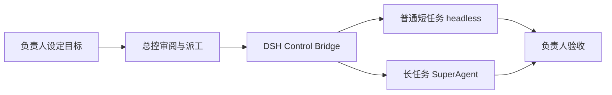

# DSH Control Bridge

协调代理与多套 DeepSeek Harness 之间的控制桥。负责人定目标，总控审阅并派工，Harness 在指定实例和工作区里执行，结果回到人这里验收。

> **开发预览，代码集成见 [PR #1](https://github.com/ft54482/dsh-control-bridge/pull/1)。**
> 这个默认分支目前是项目介绍。可运行的桥、配置样例和测试都在该 PR 的分支上，还没有合并，也不能把它们说成 main 已经具备的能力。

## 这是什么

一个人把目标交给总控。总控可以是负责人自己运行的协调代理，例如 Grok Bot。它不代替 Harness 改仓库，而是审阅阶段结果、写成给人看的说明，再把下一份任务书派回正确的实例和工作区。

Harness 负责执行，并且只有两条路：

- 范围清楚的短任务走普通会话。桥使用自己的 **headless** profile，不复用 desktop，也不去接管已经打开的桌面会话。
- 需要拆开、跨步骤持续做、并且单独交付的长任务走 **SuperAgent**。这条路径的绑定还没有核完，预览代码里不会据此自动派工。

执行器说做完了，只表示可以给人看。验收由负责人做。默认是起草下一份任务书，批准之后才发送。

本仓库是独立的开源项目。名称里的 Grok Bot 与 DeepSeek Harness 指使用中的协调代理和执行环境，不是这些产品的官方组件，也不表示 xAI、Grok 或 DeepSeek 提供支持。

## English

DSH Control Bridge is a control plane between a coordinating agent and one or more DeepSeek Harness instances. A person sets the goal. The coordinator reviews and dispatches. Harness executes in a declared instance and workspace, then a person accepts the result.

This default branch is the project introduction. The runnable preview, including tests, is on [PR #1](https://github.com/ft54482/dsh-control-bridge/pull/1) and is not merged. Nothing here claims a live connection or unattended acceptance.

## 它打算怎么工作

普通短任务和长任务分开，是因为它们的交付方式不同，不是因为预计要花多久。

| | 普通短任务 | 长任务 |
| --- | --- | --- |
| 路径 | 桥自己的 headless 普通会话 | SuperAgent |
| 现在的阶段 | 契约已按公开 CLI 说明设计，进程默认不启动 | 管理面状态不能当成派工依据，继续不自动派 |
| 完成的含义 | 待人验收 | 待人验收 |

## 多实例与多工作区

每一套 Harness 单独登记。本机 desktop 与另一套逻辑实例不能写成同一个目标。任务只能打到已经声明的实例和工作区；同名工作区在两套实例上仍然是两个目标。

隔离试验使用新建的空目录。不把正在运行的业务目录当成试验场，也不接管那些目录里已有的会话。

## 谁做什么

1. 负责人设定目标、范围和验收标准。
2. 总控阅读阶段结果，起草下一份任务书。
3. 批准之后，桥才把任务送到选定的实例和工作区。
4. Harness 执行。
5. 负责人对照证据验收。执行器自报完成不等于交付。

## 边界

- 未合并的预览代码没有被说成已经连通，也没有被说成可以无人值守。
- desktop 会话不由这条 CLI 路径启动，也不被拿来跑隔离试验。
- 凭证由操作者在以后的阶段单独配置。本介绍页不包含密钥，也不假定可以复用桌面里已经登录的身份。
- 额度声明如果出现在预览设计里，只是写给人看的上限，不是已经在计量或拦截真实调用。目标、期限和允许动作是否强制，以 [PR #1](https://github.com/ft54482/dsh-control-bridge/pull/1) 里的代码审查为准，不以本页为准。
- 官方 webhook 是外部请求进入 Harness 后新建会话，不是这座桥的完成回执。

## 路线

阶段是顺序的。缺凭证不是代码已经做完。

1. **介绍页。** 就是现在的 main 所要呈现的内容。
2. **开发预览。** 代码、假适配器和 headless 设计在 [PR #1](https://github.com/ft54482/dsh-control-bridge/pull/1)。Windows 上的真实 `dsh.cmd` 进程还没有在本环境跑过。
3. **无模型调用的假进程自检。** 在授权的新目录里确认启动方式，仍然不发送计费请求。
4. **凭证配置。** 操作者自行提供变量名与值，值不进入仓库。
5. **真实计费 smoke。** 只在前面的自检通过、并且负责人明确要求之后才讨论。

预览分支上的说明：

- [headless CLI 说明](https://github.com/ft54482/dsh-control-bridge/blob/cursor/first-public-release-9110/docs/headless-cli.md)
- [连接契约](https://github.com/ft54482/dsh-control-bridge/blob/cursor/first-public-release-9110/docs/connector-contract.md)

这些链接指向 PR 分支。main 上还没有对应文件。

## 许可证

[MIT](LICENSE)
