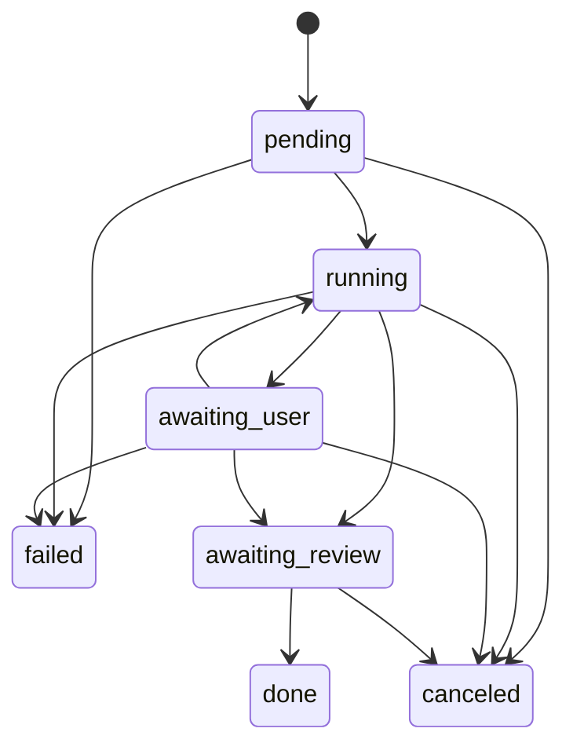

# 架构

DSH Control Bridge 0.1 是一个本地控制面，不是执行器，也不是消息队列。

## 分层

| 层 | 职责 |
| --- | --- |
| `POST /v1/events` | 接收阶段交卷、报错、等待输入、退出和取消确认。校验共享密钥，然后只保留允许的字段 |
| CLI / MCP 工具描述 | 给协调代理读收件箱、确认已读、起草或发送、查状态、取消 |
| SQLite | 任务、事件、尝试、死信、阶段摘要 |
| `audit.jsonl` | 只追加的审计。不回写，不记录 payload 原文和密钥 |
| Adapter | `fake` 在进程内 dry-run；`harness` 是拒绝发送的骨架 |

Webhook 正文不可信。签名只说明持有共享密钥的一方送来了这串字节，不说明正文里的句子是事实，更不说明负责人批准了下一步。

通知不是验收。`stage_submitted` 把已发送的任务放到 `awaiting_review`。`accept` 才是负责人的验收。`acknowledge` 只是把收件箱条目标成已读。

## 状态

进入 `awaiting_review` 之后，执行器不能再用一条 `error` 或 `started` 把任务拉走。取消可以由负责人发起。`cancel_ack` 只有在本地已经取消且确认状态还不是 `confirmed` 时，才会把确认补上。执行器自己送来的取消确认不会取消一个仍在运行的任务。

还没发送的草稿会忽略启动和交卷事件，避免一份 webhook 把草稿说成已经在跑。

## 派工

`dispatch` 的默认模式是 `draft`。配置文件不能把默认改成自动发送。

`mode=send` 在写入 in-flight 之前检查三件事：目标实例和工作区已登记、mandate 未过期且包含 `dispatch`、适配器声明自己可以发送。`harness` 适配器的 `supports_send` 是 false，所以草稿保持草稿。

发送时先把 attempt 写成 `in_flight` 并提交，再调用适配器。适配器按 `task_id` 幂等。进程若在写回 `session_id` 或 `ticket_id` 之前停掉，下次打开桥会继续这一次已批准的发送。mandate 若当时已经过期，任务进入死信，不再调用适配器。

`AdapterError` 会在同一次发送里重试。`retry_limit` 是首次失败之后还可以再试的次数，并且 mandate 要允许 `retry`。次数用尽后任务变为 `failed`，并写一条死信。这里没有无限循环，也没有睡眠退避。进程重启时，尚未写回远程 id 的 in-flight 会再续一次；那一次是原来那次批准的继续，适配器必须按 `task_id` 去重。

## 摘要

阶段摘要是中文文本，列出事件 id、目标、关联 id、commit SHA 和证据引用。证据缺失时写明缺失。桥不读取 payload 给出的路径，所以一条摘要不能把“文件里写了什么”说成已经核对过。

## 明确不做的事

- 不实现 A2A。任务要有人验收、执行器自报完成不等于交付，这些判断以后可以对照 A2A 的任务生命周期来看，但本仓库不提供 A2A 端点。
- 不把 Hookdeck 或其他托管网关当作前置。需要对外暴露时，由部署者自己反代本机的 `/v1/events`。
- 不安装商业 “Harness CI” 插件。
- 不提供看板 UI。

数据流和取消的细节以代码和测试为准：`src/dsh_control_bridge/bridge.py`、`tests/test_bridge.py`。
